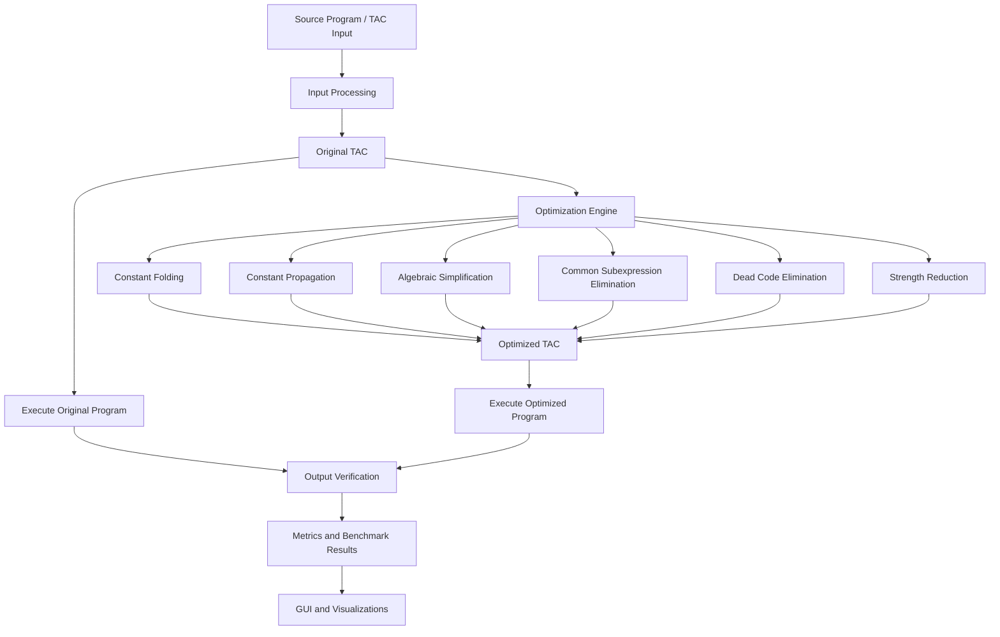

# Automated Rule-Based Compiler Code Optimizer

A Python-based compiler optimization project that improves Three-Address Code (TAC) using rule-based optimization techniques, iterative optimization passes, output verification, and benchmark analysis.

## Overview

The Automated Rule-Based Compiler Code Optimizer identifies and applies optimization opportunities in intermediate code to reduce unnecessary instructions and simplify computations while preserving program output.

The project includes a graphical user interface (GUI), an optimization engine, a FastAPI-based REST API, automated tests, and benchmark visualizations.

## Features

- **Constant Folding:** Evaluates constant expressions at compile time.
- **Constant Propagation:** Replaces variables with known constant values where applicable.
- **Algebraic Simplification:** Simplifies expressions using algebraic identities.
- **Common Subexpression Elimination (CSE):** Reuses previously computed expressions when valid.
- **Dead Code Elimination:** Removes computations whose results are not needed.
- **Strength Reduction:** Replaces supported expensive operations with simpler equivalent operations.
- **Iterative Optimization:** Applies optimization passes repeatedly until the stopping condition is reached.
- **Output Verification:** Compares original and optimized program outputs for supported test cases.
- **Benchmarking:** Collects optimization metrics and produces result summaries and graphs.
- **Graphical Interface:** Provides a GUI for interacting with the optimizer.
- **REST API:** Exposes optimizer functionality through a FastAPI application.

## System Architecture



## Technology Stack

| Component | Technology |
|---|---|
| Programming language | Python |
| Intermediate representation | Three-Address Code (TAC) |
| Optimization engine | Python rule-based modules |
| API backend | FastAPI |
| GUI | Tkinter |
| Data analysis and visualization | Matplotlib |
| Image handling | Pillow |
| Results and summaries | CSV and JSON |
| Testing | Python test modules |

## Project Structure

```text
Automated-Rule-Based-Compiler-Optimizer-Full/
├── gui/
│   └── app.py
├── optimizers/
│   ├── __init__.py
│   ├── algebraic_simplification.py
│   ├── constant_folding.py
│   ├── constant_propagation.py
│   ├── cse.py
│   ├── dead_code.py
│   ├── engine.py
│   ├── strength_reduction.py
│   └── utils.py
├── results/
│   ├── benchmark_results.csv
│   ├── benchmark_summary.json
│   └── benchmark visualization images
├── main.py
├── metrics.py
├── optimizer_api.py
├── test_optimizer_api.py
├── tests/
│   └── test_all.py
├── visualization.py
├── requirements.txt
└── README.md
```

## Installation

### Prerequisites

- Python 3.10 or a compatible version supported by the project dependencies
- pip
- Git

### 1. Clone the repository

```bash
git clone https://github.com/AakritiTiwari09/Automated-Rule-Based-Compiler-Optimizer.git
cd Automated-Rule-Based-Compiler-Optimizer
```

If the project files are inside the `Automated-Rule-Based-Compiler-Optimizer-Full` subfolder, enter it:

```bash
cd Automated-Rule-Based-Compiler-Optimizer-Full
```

### 2. Create a virtual environment

**Windows PowerShell**

```powershell
python -m venv .venv
.\.venv\Scripts\Activate.ps1
```

If PowerShell blocks activation, you can run the environment's Python directly:

```powershell
.\.venv\Scripts\python.exe -m pip install -r requirements.txt
```

**macOS/Linux**

```bash
python3 -m venv .venv
source .venv/bin/activate
pip install -r requirements.txt
```

### 3. Install dependencies

```bash
pip install -r requirements.txt
```

## Running the Project

Run the entry point appropriate to your setup.

### Launch the main application

```bash
python main.py
```

### Launch the FastAPI server

```bash
uvicorn optimizer_api:app --reload
```

If the API starts successfully, open:

- API documentation: http://127.0.0.1:8000/docs
- API root: http://127.0.0.1:8000/

Use the API routes defined in `optimizer_api.py`.

## Testing

Run the available automated tests from the project directory:

```bash
python -m pytest
```

If `pytest` is not installed or the project uses a different test runner, follow the dependencies and test instructions in the repository.

The project also supports comparing original and optimized program outputs for supported inputs. Matching outputs provide evidence of correctness for the tested cases, but do not prove equivalence for every possible program.

## Benchmarking and Evaluation

The project includes benchmark result files and visualizations in the `results/` directory.

The evaluation can include:

- Original and optimized instruction counts
- Instruction reduction
- Temporary variable reduction, where measured
- Optimization effectiveness by category
- Output verification results
- Benchmark summaries and graphs

Use the generated benchmark data as the source of reported performance figures. Results depend on the input programs and the metrics implemented by the project.

## Applications

- Learning compiler design and intermediate-code optimization
- Demonstrating rule-based optimization techniques
- Comparing code before and after optimization
- Evaluating optimization behavior on benchmark programs
- Studying output verification and optimization metrics

## Future Improvements

- Expand the supported source-language constructs.
- Add more optimization rules.
- Improve error handling and input validation.
- Expand benchmark coverage and regression tests.
- Add detailed optimization traces and performance measurements.
- Integrate additional compiler frontends and intermediate representations.

## Contributors

- **Aakriti Tiwari**
- **Vishwas Kumar**

## License

No license has been specified yet. Add a license file if you intend to permit others to reuse, modify, or distribute this project.

---

**Note:** This project is intended for educational and experimental use. Optimization behavior and correctness depend on the supported TAC syntax, implemented rules, and test coverage.
